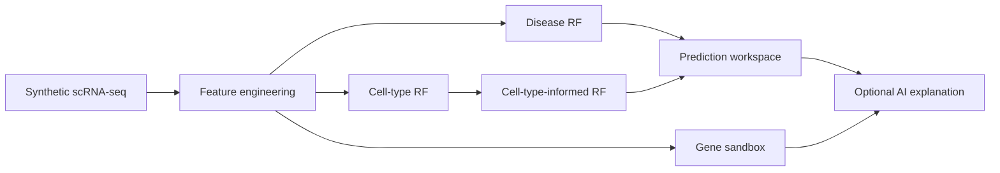

<div align="center">

# TME Explorer

**An interactive single-cell tumour microenvironment lab for exploration, prediction and what-if experiments**

[](https://github.com/Ci-yo/BIO215_Capstone_TME-Shiny/actions/workflows/repository-check.yml)


<sub>From synthetic single-cell profiles to cell-type classification, disease-state prediction and interactive gene perturbation.</sub>

</div>

## The product

`TME Explorer` is the interactive front end of the BIO215 capstone. It treats a synthetic scRNA-seq-style dataset as a small product ecosystem: users can inspect the evidence, apply three packaged Random Forest models and alter gene values in a sandbox to see how predictions respond.

| Area | Experience |
|---|---|
| Data explorer | search, filter and download 3,000 annotated synthetic cells |
| Visual analytics | compare gene, pathway and engineered-score distributions |
| Cell-type model | classify `Cancer`, `T_Cell` or `Fibroblast` profiles |
| Disease models | compare basic and cell-type-informed tumour predictions |
| Gene sandbox | run transparent “what-if” perturbation experiments |
| AI explanation | optionally translate model output with a user-supplied Gemini key |

## System map



The reusable prediction functions and bundled model engine are also published as the companion R package [`geneTMEpredict`](https://github.com/Ci-yo/BIO215_Capstone_geneTMEpredict).

## Run locally

```r
install.packages(c(
  "shiny", "shinydashboard", "DT", "ggplot2", "plotly",
  "dplyr", "randomForest", "fresh", "httr2", "jsonlite"
))
shiny::runApp()
```

The dashboard works without an AI key. To enable the optional explanation panel, copy `.Renviron.example` to `.Renviron`, add your own key locally, then restart R. `.Renviron` is intentionally ignored by Git.

```text
GEMINI_API_KEY=
```

## Repository guide

```text
BIO215_Capstone_TME-Shiny/
├── app.R                  complete dashboard UI and server
├── 01_train_models.R      reproducible model-training script
├── *.csv                  synthetic dataset and input template
├── rf_*.rds               three deployment-ready models
├── assets/                repository preview image
├── www/                   in-app workflow visual
└── scripts/               dependency-free archive check
```

## Model roles

- `rf_celltype.rds` predicts three TME cell types from six expression/pathway features.
- `rf_disease_basic.rds` predicts disease status after adding tumour, immune and stromal scores.
- `rf_disease_ct.rds` adds predicted cell type to test whether cellular context changes the result.

Run the same structural and secret-safety check used by GitHub Actions:

```bash
python scripts/validate_repository.py
```

## Responsible use

The dataset, labels and predictions are fully synthetic and designed for education and benchmarking. They are not patient data and must not be interpreted as clinical evidence.

> **Academic-use note**  
> This is a completed coursework portfolio project. Do not submit its implementation or results as your own work.
