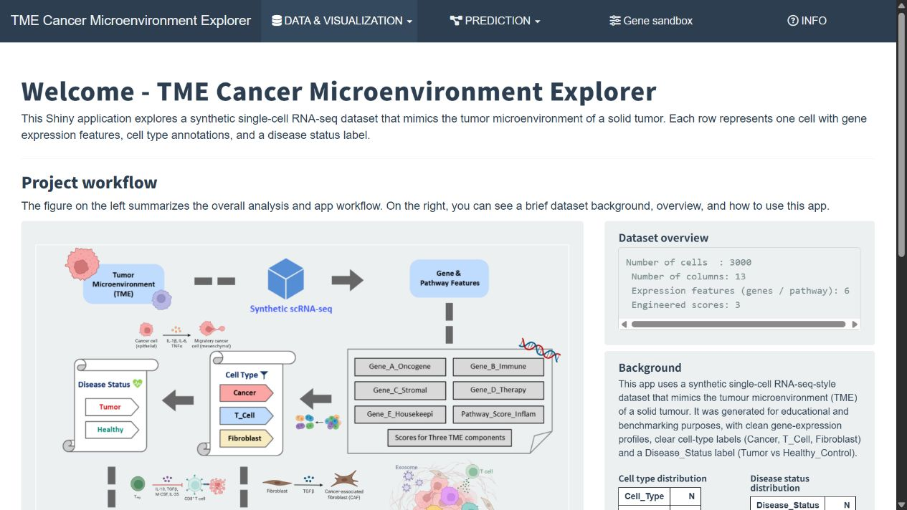
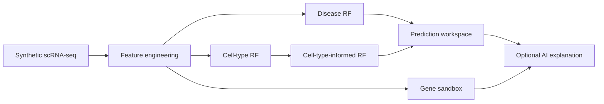

<div align="center">

# TME Explorer

**An interactive single-cell tumour microenvironment lab for exploration, prediction and what-if experiments**

[](https://github.com/Ci-yo/BIO215_Capstone_TME-Shiny/actions/workflows/repository-check.yml)
[](https://xi-yo.shinyapps.io/TME_2255737/)




<sub>From synthetic single-cell profiles to cell-type classification, disease-state prediction and interactive gene perturbation.</sub>

**[Launch the live TME Explorer →](https://xi-yo.shinyapps.io/TME_2255737/)**

</div>

## Step-by-step guide

### 1. Download the app

Install [R](https://cran.r-project.org/) (R 4.4+ recommended) and optionally
[RStudio](https://posit.co/download/rstudio-desktop/).
With [Git](https://git-scm.com/downloads) installed, run in a **terminal**:

```bash
git clone https://github.com/Ci-yo/BIO215_Capstone_TME-Shiny.git
cd BIO215_Capstone_TME-Shiny
```

Or choose **Code → Download ZIP**, extract it, and open the extracted folder.
Keep the `.rds`, `.csv`, `www/` and `app.R` files together.

### 2. Install dependencies and start the app

Open R/RStudio with that folder as the working directory. In the **R console**:

```r
stopifnot(file.exists("app.R"))
source("requirements.R")
shiny::runApp(".", launch.browser = TRUE)
```

The first call installs missing packages. The second starts a local server and
opens the dashboard. Keep R running while using the app; click **Stop** in
RStudio or press **Ctrl+C** in the terminal to end it.
No training step is needed: the model files are included.

### 3. Classify the included example cells

1. Open **Cell type prediction → Multiple (CSV)**.
2. Tick **Use example input from gene_input_example.csv**.
3. Click **Run cell type prediction**.
4. Inspect `Pred_Cell_Type` and the `Cancer`, `T_Cell`, `Fibroblast`
   probability columns.
5. Click **Download predictions (.csv)**.

Then open **Disease prediction → Multiple (CSV)**, tick its example-input
checkbox, leave the cutoff at `0.5`, and click **Run disease prediction**.
Compare `Pred_Tumor_Prob_basic` / `Pred_Label_basic` with
`Pred_Tumor_Prob_ct` / `Pred_Label_ct`, then download the results.
These are separate views; selecting an example in one does not select it in
the other.

### 4. Supply your own feature table

Start from [`gene_input_example.csv`](gene_input_example.csv). Each row
represents one synthetic cell profile with six numeric columns:

```text
Gene_E_Housekeeping,Gene_A_Oncogene,Gene_B_Immune,Gene_C_Stromal,Gene_D_Therapy,Pathway_Score_Inflam
```

Upload the CSV, untick the example-input checkbox, and press the relevant
**Run** button again. Keep the exact headers and avoid missing values.
The engineered scores are calculated internally; they need not be supplied.
These placeholder gene features are from a synthetic teaching dataset, so an
arbitrary real scRNA-seq count matrix cannot be substituted directly.

### 5. Optional explanations and model retraining

The prediction tabs work without an API key. To enable the Gemini explanation
buttons, copy `.Renviron.example` to `.Renviron`, set `GEMINI_API_KEY` locally,
and restart R. Explanation requests send the constructed model/context prompt
to the external service; prediction itself remains local. Keep the key out of Git.

Retraining is optional and replaces the three `rf_*.rds` files and the example
CSV in that checkout. Use a separate copy if you want to preserve them:

```bash
Rscript 01_train_models.R
```

### 6. Troubleshooting and verification

| Symptom | Action |
|---|---|
| `file.exists("app.R")` is false | Select the repository as RStudio's working directory. |
| `shinythemes`, `shinydashboard` or `httr` is missing | Run `source("requirements.R")`; it lists the packages actually loaded by `app.R`. |
| The table stays empty | Choose the example or upload a CSV, then click the corresponding Run button. |
| An AI explanation fails | Check the local key/service separately; the prediction tabs do not require it. |
| Hosted app cannot be reached | Follow the local startup steps above. |

Optional structural check, in a **terminal** with Python 3.10+:

```bash
python scripts/validate_repository.py
```

The included synthetic labels and predictions are for education, not clinical
use. The companion [`geneTMEpredict`](https://github.com/Ci-yo/BIO215_Capstone_geneTMEpredict)
package offers prediction functions without a dashboard.

## The product

`TME Explorer` is the interactive front end of the BIO215 capstone. It treats a synthetic scRNA-seq-style dataset as a small product ecosystem: users can inspect the evidence, apply three packaged Random Forest models and alter gene values in a sandbox to see how predictions respond.

| Area | Experience |
|---|---|
| Data explorer | search, filter and download 3,000 annotated synthetic cells |
| Visual analytics | compare gene, pathway and engineered-score distributions |
| Cell-type model | classify `Cancer`, `T_Cell` or `Fibroblast` profiles |
| Disease models | compare basic and cell-type-informed tumour predictions |
| Gene sandbox | run transparent “what-if” perturbation experiments |
| AI explanation | optionally translate model output with a user-supplied Gemini key |

## System map



The reusable prediction functions and bundled model engine are also published as the companion R package [`geneTMEpredict`](https://github.com/Ci-yo/BIO215_Capstone_geneTMEpredict).

## Repository guide

```text
BIO215_Capstone_TME-Shiny/
├── app.R                  complete dashboard UI and server
├── 01_train_models.R      reproducible model-training script
├── *.csv                  synthetic dataset and input template
├── rf_*.rds               three deployment-ready models
├── assets/                repository preview image
├── www/                   in-app workflow visual
└── scripts/               dependency-free archive check
```

## Model roles

- `rf_celltype.rds` predicts three TME cell types from six expression/pathway features.
- `rf_disease_basic.rds` predicts disease status after adding tumour, immune and stromal scores.
- `rf_disease_ct.rds` adds predicted cell type to test whether cellular context changes the result.

Run the same structural and secret-safety check used by GitHub Actions:

```bash
python scripts/validate_repository.py
```

## Responsible use

The dataset, labels and predictions are fully synthetic and designed for education and benchmarking. They are not patient data and must not be interpreted as clinical evidence.

> **Academic-use note**  
> This is a completed coursework portfolio project. Do not submit its implementation or results as your own work.
